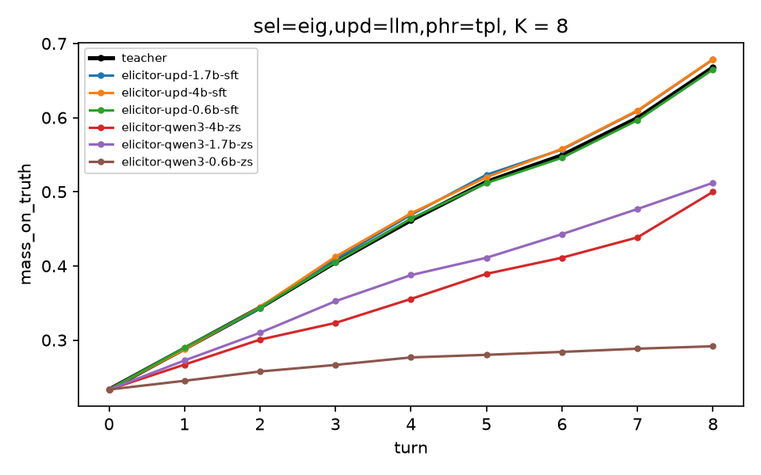

# Elicitor-Distill

Small open models trained to replace the two large models inside
[Elicitor](https://github.com/LhyJason/elicitor), an LLM agent that learns what a user wants by
choosing clarifying questions by expected information gain. Elicitor's belief updater is
qwen3 32B and its judge is llama3.3 70B. Here Qwen3 0.6B, 1.7B and 4B students are fine-tuned
with LoRA on the teachers' replies and checked the way the teachers were: against the teacher's
outputs, against the measured answer reliability, and end to end in Elicitor's own experiment
with paired tests on 48 held-out simulated users.

**Result.** The fine-tuned 1.7B updater is non-inferior to the 32B teacher end to end (mass on
truth after 5 questions +0.0095, one-sided 95 % lower bound +0.0054 against a margin of −0.02),
serves 9.8 × as many requests per second on one GPU in a sixth of the memory, and runs Elicitor's
interactive demo on a laptop GPU with 6 GB. All three fine-tuned sizes are non-inferior; no
zero-shot base is, although the zero-shot 4B ranks the right value first about as often as the
teacher. The 1.7B judge student tracks the true utility at Spearman 0.832, 0.04 below its 70B
teacher, and misses the pre-registered bar narrowly.

Hypotheses, thresholds and predictions were frozen in [docs/SPEC.md](docs/SPEC.md) (§7.4) before
any test data was read; every design decision is recorded there.

## How it works

Elicitor keeps one probability distribution per preference slot (climate, pace, lodging, …). After
each question the **updater** reads the user's free-text answer and scores every value of the slot
0–10; Bayes' rule is then applied in code. The **judge** scores how well a catalog item fits a
user profile and is used to check recommendations against the true utility. Both are single-turn
JSON tasks, which makes them good targets for distillation.

1. **Teacher data.** 160 new training personas (disjoint from Elicitor's 60) answer 45 questions
   each through Elicitor's simulated user (llama3.3 70B); the 32B teacher scores every answer,
   and the 70B judge scores 25 catalog items per persona, spread over the utility range. Elicitor's
   12 development personas are the validation set; its 48 evaluation personas are the test set and
   are not read before the final evaluation (a flag in the code guards them). The SFT sets are in
   the repo: `data/sft/` (5,704 + 516 `update`, 4,000 + 300 `judge` rows).
2. **Training.** Sequence-level distillation: LoRA (r 16) on the teacher's reply, loss on the
   reply only, thinking off, best epoch by validation agreement. One A40, 22–37 minutes per model.
3. **Serving.** The merged model is converted to a Q8_0 GGUF and served by Ollama with an explicit
   chat template matching the training rendering (checked against the server's logged prompts),
   so Elicitor runs it through its existing `ollama` provider with no code change.
4. **Evaluation.** Three layers: offline agreement with the teacher on 4,086 de-duplicated test
   samples; the answer reliability ρ each model implies (Elicitor's `calibrate`); and Elicitor's
   end-to-end experiment on the 48 test personas, with the student in place of the teacher.
   Zero-shot Qwen3 bases go through the same GGUF path as baselines.

The end-to-end comparison is clean because Elicitor uses common random numbers: a question gets
the same simulated answer whichever model asks it, so with template wording the updater is the
only difference between a student run and the teacher run. Every fine-tuned student asked exactly
the teacher's question sequence in all 1,440 of its episodes.

## Results

All numbers are from `results_summary/m3/` (one evaluation job, 2 h 28 min on 4 A40s, 1,440
episodes per model, no failed calls and no parse failures in any role).

### End to end: `eig` selector, 5 questions, 48 test personas × 5 replicates

Paired by persona (replicate means first), bootstrap 95 % CI of model − teacher. Non-inferior
means the one-sided 95 % lower bound is above −0.02 on mass on truth **and** above −0.03 on MAP
accuracy. The teacher reaches 0.5135 mass on truth and 0.6556 MAP accuracy.

| updater | mass on truth − teacher | MAP accuracy − teacher | log loss − teacher | verdict |
|---|---:|---:|---:|---|
| SFT 0.6B | −0.0017 [−0.0074, +0.0038] | −0.0060 [−0.0120, −0.0009] | −0.002 | non-inferior |
| **SFT 1.7B** | **+0.0095 [+0.0047, +0.0148]** | −0.0028 [−0.0079, +0.0014] | −0.030 | non-inferior |
| SFT 4B | +0.0061 [−0.0018, +0.0137] | −0.0005 [−0.0046, +0.0032] | −0.021 | non-inferior |
| zero-shot 0.6B | −0.2333 [−0.2469, −0.2190] | −0.1981 [−0.2472, −0.1514] | +0.710 | not shown |
| zero-shot 1.7B | −0.1024 [−0.1132, −0.0916] | −0.0227 [−0.0347, −0.0120] | +0.217 | not shown |
| zero-shot 4B | −0.1241 [−0.1350, −0.1127] | −0.0009 [−0.0074, +0.0051] | +0.273 | not shown |



The pattern holds for the `random` selector and at 3 and 8 questions (`results_summary/m3/results.md`,
Holm-corrected over all 36 comparisons per metric): every fine-tuned student stays within ±0.011
of the teacher's mass on truth, every zero-shot base loses 0.05–0.38.

### Offline agreement with the teacher (4,086 test samples)

| updater | argmax agreement | score MAE (0–10) | Spearman | KL(teacher ‖ model) |
|---|---:|---:|---:|---:|
| zero-shot 0.6B | 0.480 | 3.77 | 0.500 | 0.554 |
| zero-shot 1.7B | 0.921 | 1.58 | 0.806 | 0.289 |
| zero-shot 4B | 0.956 | 1.46 | 0.844 | 0.246 |
| SFT 0.6B | 0.976 | 0.39 | 0.961 | 0.073 |
| SFT 1.7B | 0.980 | 0.40 | 0.966 | 0.072 |
| SFT 4B | 0.987 | 0.30 | 0.974 | 0.056 |

Agreement alone would have called zero-shot 4B nearly as good as the teacher. It is not: it picks
the right top value but spreads its scores, so its likelihoods are flatter (KL 0.246 against 0.056)
and the posterior concentrates more slowly. KL between the normalised likelihoods is the quantity
that enters Bayes' rule, and it is what fine-tuning fixes. On validation, no zero-shot base
produced one valid reply without schema-constrained decoding; the students did 99–100 % of the time.

### Throughput (one A40, 200 `update` requests, 16 concurrent, 8 Ollama slots)

| model | requests / s | p50 latency | p95 latency | GPU memory |
|---|---:|---:|---:|---:|
| qwen3 32B (teacher) | 0.875 | 16.5 s | 23.8 s | 23,611 MiB |
| SFT 4B | 5.13 | 2.6 s | 4.6 s | 6,883 MiB |
| **SFT 1.7B** | **8.61** | **1.7 s** | **2.4 s** | **3,977 MiB** |
| SFT 0.6B | 10.30 | 1.4 s | 2.3 s | 2,823 MiB |

### Judge student (256 test units with known utility)

| judge | Spearman with utility | 95 % CI | Spearman with teacher | exact score |
|---|---:|---|---:|---:|
| llama3.3 70B (teacher) | 0.871 | [0.827, 0.906] | – | – |
| SFT 1.7B | 0.832 | [0.790, 0.868] | 0.905 | 0.688 |
| zero-shot 4B | 0.758 | [0.685, 0.819] | 0.813 | 0.121 |

### Pre-registered hypotheses

| | Hypothesis (frozen before the test data was read) | Found |
|---|---|---|
| D1 | Zero-shot 4B is worse than the teacher: agreement < 0.90 and mass on truth below −0.02 | **does not hold**: agreement 0.956; mass on truth −0.124 (only that half holds) |
| D2 | SFT 4B is non-inferior end to end | **holds** |
| D3 | SFT 1.7B is non-inferior end to end | **holds**, above the teacher on mass on truth |
| D4 | After SFT, agreement rises with size and the 1.7B–4B gap halves | **holds**: 0.976 < 0.980 < 0.987; gap 0.007 against 0.035 zero-shot |
| D5 | SFT 1.7B judge: Spearman with utility, 95 % lower bound ≥ 0.80 | **does not hold**, narrowly: 0.790 |
| D6 | SFT 1.7B serves `update` at ≥ 5 × the teacher's rate | **holds**: 9.8 × |

## Laptop demo

Elicitor's terminal demo with the SFT 1.7B student as the updater, on an RTX 3060 Laptop GPU
(6 GB) under Ollama 0.24 for Windows: about 3.9 GB of GPU memory and 1.2–2.0 s per answer. The
same GGUF reproduces the cluster's validation numbers on the laptop (agreement 0.973 against
0.972, KL 0.074 against 0.075).

```text
[1/8] What kind of surroundings would you like at your destination?
> I'd love to be near the water, falling asleep to the sound of waves.

> setting      #################... 0.84  beach
...
[2/8] What type of accommodation would you like to stay in?
> I'd rather have my own place with a kitchen than a hotel room.

  lodging:
    hotel          .................... 0.02
    rental         #########........... 0.47
    hostel         #####............... 0.24
    camping        #####............... 0.24
```

The whole session, including one answer the student misreads where the teacher would not, is in
[docs/demo_transcript.md](docs/demo_transcript.md).

```bash
ollama create elicitor-upd-1.7b-sft -f Modelfile   # a GGUF from `distill export`; see below
elicitor demo experiments/demo_student.toml
```

Use Ollama 0.24 (the version of every result here). Ollama 0.40 writes the keys of a nested JSON
object in alphabetical order under schema-constrained decoding, not in the schema's order, and the
student, trained on the schema's order, drops to 0.936 agreement there.

## Reproducing

```bash
python -m venv .venv
source .venv/bin/activate        # Windows: .venv\Scripts\activate
pip install -e ".[dev]"          # Elicitor is installed from GitHub at a pinned commit
ruff check . && ruff format --check . && pytest
distill make-personas --check    # the frozen training personas match the generator
distill collect experiments/collect_mock.toml --out results/collect_mock   # mock teachers
```

Everything below needs GPUs and Ollama; the cluster scripts are in `cluster/` (Slurm; site
settings go in an untracked `cluster/local.env`, see `local.env.example`).

```bash
# teacher data (cluster/collect.sbatch); the frozen output is already in data/sft/
distill collect experiments/collect.toml --out data/raw/collect
distill judge-collect experiments/collect.toml --out data/raw/collect
distill build-sft --raw data/raw/collect

# one student (cluster/train.sbatch; pip install -e ".[train]")
distill train configs/update_1.7b.toml --base-dir ~/hf
distill export elicitor-upd-1.7b-sft --base ~/hf/Qwen3-1.7B \
    --adapter models/upd-1.7b-sft/adapter --llama-cpp ~/llama.cpp --create
distill eval-offline --model elicitor-upd-1.7b-sft --out results/m2/upd-1.7b-sft/update
distill bench --model elicitor-upd-1.7b-sft

# end to end (cluster/e2e.sbatch): needs Elicitor's own run folders for the teacher side
distill build-test --m5 <elicitor>/results/m5_full --judge <elicitor>/results/m7_judge --allow-eval
distill m3-file experiments/m3_e2e.toml --model elicitor-upd-1.7b-sft --name e2e_upd-1.7b-sft \
    --calibration results/m3/upd-1.7b-sft/calibration/calibration.json \
    --out experiments/m3/e2e_upd-1.7b-sft.toml
elicitor run experiments/m3/e2e_upd-1.7b-sft.toml --out results/m3/upd-1.7b-sft/run
distill compare results/m3/*/run --teacher <elicitor>/results/m5_full --out results/m3/compare
distill judge-eval results/m3/judge-1.7b-sft/judge_test
```

`data/travel/` is a verbatim copy of Elicitor's domain files at the pinned commit, checked against
`CHECKSUMS.sha256`. `experiments/m3/` holds the exact run files, each with the model's measured ρ.

## Limitations

- One domain (trip planning), synthetic users and a simulated answerer. "Non-inferior to the
  teacher" is measured inside Elicitor's simulation, not with people.
- The students imitate the teacher, errors included; nothing here corrects the teacher against
  the truth. The 1.7B's small gain over the teacher is real in this test but is not an argument
  that distillation improves on the teacher in general.
- Only the updater and the judge are distilled. The selector `eig_mc` also calls the agent model
  to imagine answers, which no student learned, so it was left out.
- Throughput is one benchmark on one GPU type with one server setting (8 parallel slots); the
  teacher was measured under the same load, not tuned for it.
- The judge student misses its frozen bar (lower bound 0.790 against 0.80).
- The students depend on the serving stack writing JSON keys in the trained order; see the Ollama
  version note under the demo.

## License

Code: MIT, see [LICENSE](LICENSE). Model weights are not released. The students' bases are Qwen3
(Apache-2.0), but their training inputs and the judge labels are outputs of Llama 3.3, whose
community license attaches naming and attribution terms to models trained on its outputs and
distributed; version 1 distributes no weights, only code, data and results (SPEC §11).
